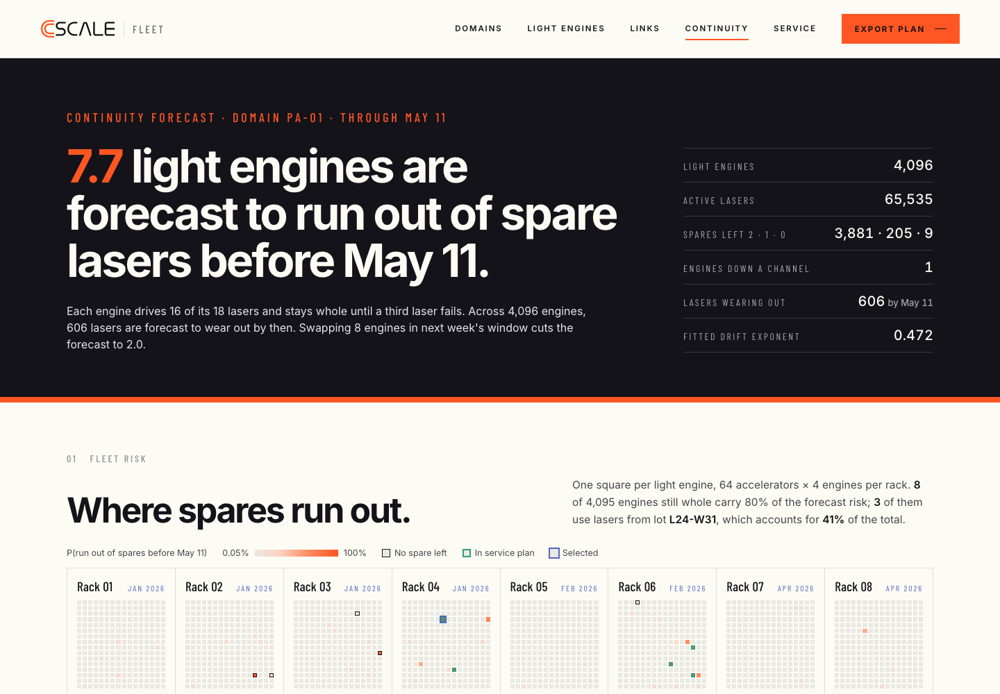

# Continuity forecast for N-of-M light engines (CScale concept)

**Live demo:** https://mohith26.github.io/cscale-continuity-forecast/

An unofficial concept feature for [CScale](https://www.cscale.ai), built by Mohith Gajjela. Not affiliated with CScale. All data is synthetic.



## What it is

CScale's thesis is "Lasers will fail. Compute shouldn't." Its public patents describe light engines with **M selectable lasers of which N carry traffic** (the worked example is 16 of 18), with the controller picking lasers by measured quality and powering spares on when a laser fails. The patents size M once, at design time, from a reliability analysis "assuming an operating environment."

This demo is the fleet-operations side of that idea, as a page in an imagined **CScale Fleet** console:

- **Forecast** every active laser's drive-current drift (the standard laser aging signal) to the end of a horizon.
- **Calibrate** those forecasts against how the same forecasts did one horizon ago (split conformal prediction), so a "30%" really means about 30%.
- **Roll up** to each light engine: the probability it runs out of spares (more than M - N failures) before the next service window.
- **Plan** the window: an exact optimizer picks which engines to swap under a swap budget and a limit on racks opened.

## How it works

1. **Aging model.** Drift at constant output power follows `D = A (AF * t)^m`, with `AF` an Arrhenius factor from the engine's temperature (Ea = 0.45 eV, 70 C reference). The exponent `m` is pooled across the fleet (median of per-laser slopes on high-signal points); each laser gets its own `A` from its last 12 weekly readings. End of life is +20% drift. Sudden failures are a 30 FIT hazard.
2. **Backtest.** For every laser that was alive one horizon ago, refit using only data up to then, forecast today's drift, and compare with today's measurement. The error, divided by `log((age + H) / age)` so young and old lasers are comparable, is the nonconformity score.
3. **Mondrian conformal.** Scores are kept separately for three drift bands at the forecast origin (<3%, 3-8%, >8%), so lasers that are already degrading are calibrated against lasers that were degrading, not against the healthy majority.
4. **Probabilities.** A laser's chance of wearing out by the horizon is the share of its band's scores that would push its forecast past +20%. Lasers with fewer than 4 readings borrow the fleet's fitted distribution for their laser lot.
5. **Engine roll-up.** P(engine loses a channel) = P(K > spares left), K ~ Poisson-binomial over its 16 active lasers (exact DP).
6. **Service plan.** Maximize forecast risk removed subject to at most B swaps and at most V racks opened. Racks are independent given the counts, so a DP over racks x swaps x racks-opened is exact (checked against brute force in the tests).

Everything shown is computed in the browser from the seeded simulator in `core/continuity.js`.

## The synthetic fleet

`simulate(20261110)`: one scale-up domain, 16 racks x 64 accelerators x 4 light engines = 4,096 engines, 18 lasers each (16 active, 2 spares powered off and not aging, per the patent's assumption). Racks were installed in waves from Jan to Sep 2026. Laser prefactors are lognormal (sd 0.35) with per-laser exponents `m ~ N(0.5, 0.05)`; 0.3% of lasers are "weak" (5.5x faster aging), except lot **L24-W31**, used in half the engines of the four newest racks, where 3% are weak. Engine temperatures run about 61-75 C. Because the simulator knows each laser's true parameters, the page can score forecasts and plans against the truth (labeled "simulator truth").

## Results on the demo fleet (26-week horizon, through May 11 2027)

- Forecast: **7.7** engines run out of spares (simulator truth 6.1; model-only forecast 3.3). **606** lasers forecast to wear out (truth 582; model-only 380).
- Plan: **8 swaps in 4 racks** take expected channel losses (truth) from 6.1 to 0.1.
- Swaps needed to get expected losses under 0.5: **8** ranking by calibrated probability, 13 by model-only probability, **234** ranking by drift and spares left (how threshold alarms prioritize).

## Does it hold up? (`node scripts/validate.mjs 20 26`)

20 freshly simulated fleets, 26-week horizon (medians, [min, max]):

| | Calibrated | Model only | Truth |
|---|---|---|---|
| Lasers wearing out, forecast / truth | 1.02 [1.00, 1.06] | 0.65 [0.63, 0.69] | 1 |
| 90% upper bound covers true drift | 94.8% | 86.6% | target 90% |
| Engines losing a channel | 9.3 | 3.9 | 9.1 |
| Swaps to reach 0.5 expected losses | 11 [3, 20] | 41 [3, 127] | drift ranking 367 [19, 1445] |

The calibrated bound over-covers (95% vs a 90% target): it is conservative rather than exact.

## Tests

```
node --test test/continuity.test.mjs
```

7 tests: Poisson-binomial tail vs brute force, Arrhenius and drift consistency, deterministic simulation and N-of-M sparing, DP optimality vs brute force, calibration against truth on two seeds, calibrated vs drift-ranked swaps on three seeds, and the plan evaluator.

## Honest limitations

- **Everything about the hardware is assumed.** CScale has not published its laser physics, telemetry, failure rates or service model. The 16-of-18 layout comes from its patents; the aging law, rates, lots and temperatures are textbook-style assumptions. The method only needs a per-laser health series and an end-of-life threshold, so it would work on estimated BER or power margin instead of drive current.
- **Exchangeability.** The backtest assumes last quarter's forecast errors look like this quarter's. A new failure mechanism (e.g. a packaging issue) would break that; the drift bands help, a monitor on realized vs forecast failures would be the next step.
- **Spares are assumed not to age while powered off**, and a swapped engine is assumed fresh.
- **Independence across engines.** Shared causes (a rack's cooling, a lot) are captured only through the per-engine inputs, not as correlated shocks.
- **The plan scores engine swaps only.** It ignores drain cost differences between racks, technician routing, and partial repairs.
- **Synthetic data and a brand-system UI.** CScale has no public software product, so there are no in-app screenshots to copy; the page follows cscale.ai's design system (colors and layout from its CSS; GT Planar and Gravur Condensed are replaced by Inter and Barlow Condensed).

## Novelty

CScale's patents describe selecting N of M lasers from current quality feedback and note that tracking degradation over time can trigger reselection; spare counts are sized at design time. Fabric managers such as NVIDIA UFM offer predictive link-failure alerts, and laser drift monitoring is standard reliability practice. I could not find a product that forecasts spare exhaustion for N-of-M light engines with calibrated (conformal) probabilities and turns it into an exact service-window plan.

## Files

- `index.html`, `style.css`, `app.js`: the Fleet console page (CDN: Google Fonts)
- `core/continuity.js`: simulator, forecasting, conformal calibration, engine roll-up, DP planner, evaluation
- `scripts/validate.mjs`, `scripts/generate.mjs` (writes `data/fleet-summary.json`)
- `test/continuity.test.mjs`

Unofficial concept demo by Mohith Gajjela. Not affiliated with CScale. Synthetic data.
